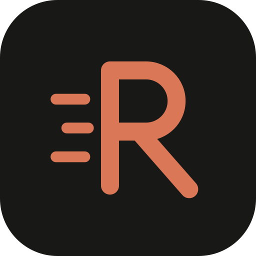

<p align="center"></p>

# Runner

**Tape deux fois dans tes mains, et ton poste se prépare tout seul.** Ta musique démarre, tes LED s'allument (et peuvent clignoter au rythme de la musique). Une voix te donne l'heure, la météo, ton prochain cours et tes nouveaux mails, et tes apps s'ouvrent, chacune placée au bon endroit sur tes écrans.

Pas besoin de taper dans tes mains ? Un raccourci clavier (**Ctrl + Alt + R**) fait la même chose.

Tout se règle depuis une fenêtre, sans toucher au code. Le détail de chaque réglage est dans [`DOCUMENTATION.md`](DOCUMENTATION.md), aussi lisible dans la fenêtre : page **Aide**, ou lien « Aide › » à côté du titre de chaque section.

---

## Installation (5 minutes)

Runner fonctionne sous **Windows 10 ou 11** uniquement.

1. Télécharge la dernière version : page **Releases** du projet sur GitHub, puis **Source code (zip)**.
2. **Décompresse-le** (clic droit sur le zip → **Extraire tout**) dans le dossier où Runner restera, par exemple `C:\Runner`. Range tes musiques dans un sous-dossier `musiques`.
3. Double-clique sur **`installer.bat`**.

L'installeur vérifie ton PC et installe seulement ce qui manque : Python (avec winget, l'installeur de Windows), les 4 bibliothèques de Runner, puis le raccourci **« Runner »** du Bureau. Il affiche le résultat de chaque étape et ouvre ensuite la fenêtre de réglages. Il ne demande pas de droits administrateur.

Si Windows affiche un avertissement de sécurité au double-clic (« Windows a protégé votre ordinateur » : **Informations complémentaires → Exécuter quand même** ; ou « Voulez-vous ouvrir ce fichier ? » : **Ouvrir**), c'est normal pour un fichier téléchargé non signé. L'installeur retire ensuite cette marque des fichiers de Runner.

<details>
<summary>Installation à la main (sans l'installeur)</summary>

```
winget install Python.Python.3.13
python -m pip install -U sounddevice numpy soundfile edge-tts
cd C:\Runner
python runner_reglages.py
```
Si tu installes Python depuis python.org, coche **« Add python.exe to PATH »**. La fenêtre de réglages crée le raccourci du Bureau à sa première ouverture.
</details>

---

## Premier réglage

1. **Détection** : choisis ton micro, puis clique sur **Calibrer automatiquement** (5 doubles claps, puis 8 s de parole).
2. **Apps** : ajoute tes apps, choisis l'écran et la position de chacune.
3. **Musique** et **Voix** : choisis ta musique, ta voix et le texte de la phrase.
4. *(Optionnel)* **LED** : active « LAN Control » dans l'app Govee Home, puis clique sur « Rechercher ».
5. *(Optionnel)* **Infos** : ta ville pour la météo, le lien de ton emploi du temps (.ics) ou le fichier téléchargé, et tes boîtes mail.
6. **Système** : coche « Lancer Runner à l'ouverture de session ».
7. Clique sur **Enregistrer**, puis sur **Tester tout**, et tape deux fois dans tes mains.

---

## Au quotidien

| Pour… | Fais… |
|---|---|
| Lancer Runner | Double clap, ou **Ctrl + Alt + R** (modifiable dans Système) |
| Arrêter la musique | Touche Lecture/Pause ou Stop du clavier, **Ctrl + Alt + M**, ou le bouton Stop de la fenêtre |
| Changer un réglage | Raccourci « Runner » du Bureau, puis **Enregistrer** |
| Voir ce qui s'est passé | Page **Journal** de la fenêtre |

Runner écoute le micro 10 min après l'ouverture de session (ou la sortie de veille), puis le ferme. Le raccourci clavier reste disponible ensuite, y compris après un lancement pour relancer Runner.

---

## En cas de problème

| Problème | Solution |
|---|---|
| Les claps ne sont pas détectés, ou ta voix déclenche Runner | Page Détection : **Calibrer automatiquement**. Désactive aussi la réduction de bruit du pilote du micro, qui efface souvent les claps. |
| Les LED ne s'allument pas | « LAN Control » activé dans Govee Home ? LED et PC sur le même réseau ? Sur un réseau d'école (eduroam), utilise le point d'accès du PC (page Système). |
| Les LED s'allument, mais le journal dit « sans réponse » | Le pare-feu bloque leurs réponses : autorise Python sur les réseaux privés. |
| Le raccourci du Bureau ne marche plus | Relance **`installer.bat`** : il répare le raccourci. |
| Après une mise à jour de Python | Relance **`installer.bat`** : il réinstalle les bibliothèques. |
| Gmail : « Gmail refuse ce mot de passe » | Google refuse le mot de passe du compte : page Infos, clique sur **Créer ›** à côté de la case et colle la clé obtenue (validation en deux étapes requise). Détail dans l'aide, partie Mails. |
| Gmail : « connexion Google expirée » | Page Infos : **Se connecter avec Google** à nouveau. Si ça revient chaque semaine, ton projet Google est resté en statut « Test » : publie-le (voir l'aide, partie Mails). |
| La voix ne parle pas, ou dit la phrase de secours | La voix neuronale a besoin d'Internet. Sans Internet, Runner utilise la voix de Windows. |

---

## Mettre à jour, désinstaller

**Version :** affichée en bas du menu de la fenêtre de réglages. Les nouveautés de chaque version sont dans [`CHANGELOG.md`](CHANGELOG.md).

**Mettre à jour :** télécharge la nouvelle version (page **Releases** du projet), remplace les fichiers du dossier de Runner par les nouveaux (tes réglages, dans `config.json`, sont gardés), puis lance `installer.bat`.

**Désinstaller :** page Système › **Désinstaller Runner…**, ou double-clic sur `desinstaller.bat`. Après confirmation, Runner retire tout ce qu'il a mis sur le PC : réglages, mots de passe et connexions (révoquées chez Google), lancement automatique, raccourcis, fichiers temporaires et son dossier. Tes musiques, et Python s'il a été installé pour Runner, ne sont supprimés que si tu le choisis. Détail dans [`DOCUMENTATION.md`](DOCUMENTATION.md#désinstaller).

---

## Fichiers

| Fichier | Rôle |
|---|---|
| `runner.py` | Le programme : écoute, détection, lancement. |
| `runner_reglages.py` | La fenêtre de réglages. |
| `installer.bat`, `installer.ps1` | L'installeur (et réparation) : Python, bibliothèques, raccourci. |
| `desinstaller.bat`, `desinstaller.ps1` | Retire Runner sans laisser de trace. |
| `DOCUMENTATION.md` | Le détail de chaque réglage (aussi affiché dans la page Aide de la fenêtre). |
| `CHANGELOG.md` | Nouveautés de chaque version. |
| `runner.ico` | Le logo : icône des raccourcis et des fenêtres. |
| `logo.png`, `logo.svg` | Le logo en image (README) et en version modifiable. |
| `config.json` | Tes réglages (créé au premier enregistrement). Il contient des informations personnelles : ne le partage pas. |
| `runner.log` | Le journal. |
| `musiques\` | Tes musiques (mp3, wav, wma, m4a). |
| `cache_rythme\` | Analyses des musiques pour le mode rythme des LED (recréées au besoin). |
| `installation.json` | Ce que l'installeur a installé sur ce PC, pour que la désinstallation ne retire que cela. |
| `google_client.json` | Optionnel : ID client Google, pour la connexion Gmail par Google plutôt que par mot de passe d'application. Ne le publie pas. |

**Confidentialité :** tout reste sur ton PC. Les mots de passe des boîtes mail (pour Gmail, un mot de passe d'application, jamais celui du compte ; ou, en option, la connexion officielle de Google en lecture seule) sont gardés par Windows (Gestionnaire d'identification), jamais dans un fichier du projet. Runner se connecte seulement à la météo (Open-Meteo), à la voix (Microsoft Edge TTS), à ton emploi du temps et à tes boîtes mail.

---

## Licence

Ce projet est **open source**, sous **licence MIT**. Tu peux librement l'utiliser, le copier, le modifier, le fusionner avec d'autres projets, le publier, le distribuer, le vendre ou l'intégrer à un produit, **à des fins privées comme commerciales**.

```
MIT License

Copyright (c) 2026 Timothée Adjanohoun

Permission is hereby granted, free of charge, to any person obtaining a copy
of this software and associated documentation files (the "Software"), to deal
in the Software without restriction, including without limitation the rights
to use, copy, modify, merge, publish, distribute, sublicense, and/or sell
copies of the Software, and to permit persons to whom the Software is
furnished to do so, subject to the following conditions:

The above copyright notice and this permission notice shall be included in all
copies or substantial portions of the Software.

THE SOFTWARE IS PROVIDED "AS IS", WITHOUT WARRANTY OF ANY KIND, EXPRESS OR
IMPLIED, INCLUDING BUT NOT LIMITED TO THE WARRANTIES OF MERCHANTABILITY,
FITNESS FOR A PARTICULAR PURPOSE AND NONINFRINGEMENT. IN NO EVENT SHALL THE
AUTHORS OR COPYRIGHT HOLDERS BE LIABLE FOR ANY CLAIM, DAMAGES OR OTHER
LIABILITY, WHETHER IN AN ACTION OF CONTRACT, TORT OR OTHERWISE, ARISING FROM,
OUT OF OR IN CONNECTION WITH THE SOFTWARE OR THE USE OR OTHER DEALINGS IN THE
SOFTWARE.
```

La licence couvre le code du projet, pas les fichiers que tu y ajoutes. Les musiques restent soumises à leurs propres droits, et les voix edge-tts aux conditions d'utilisation de Microsoft.
